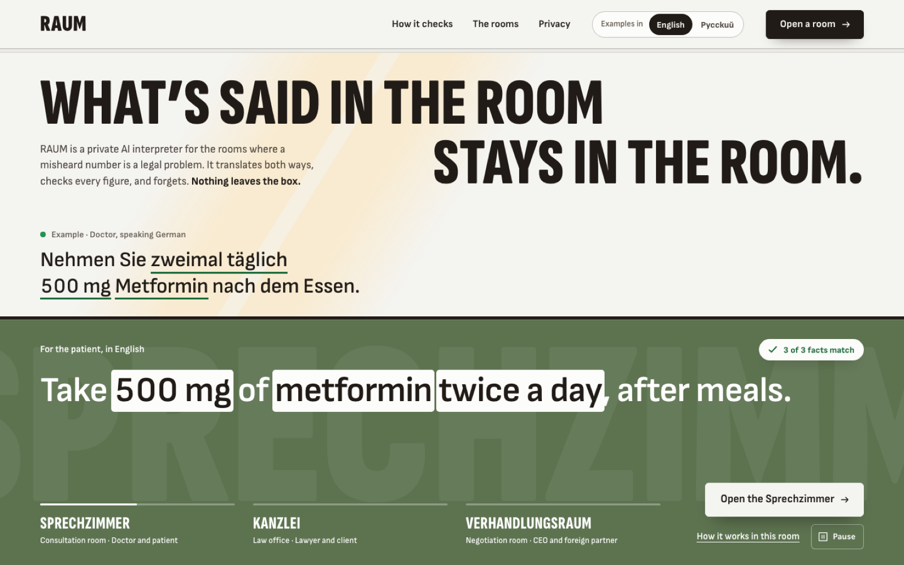
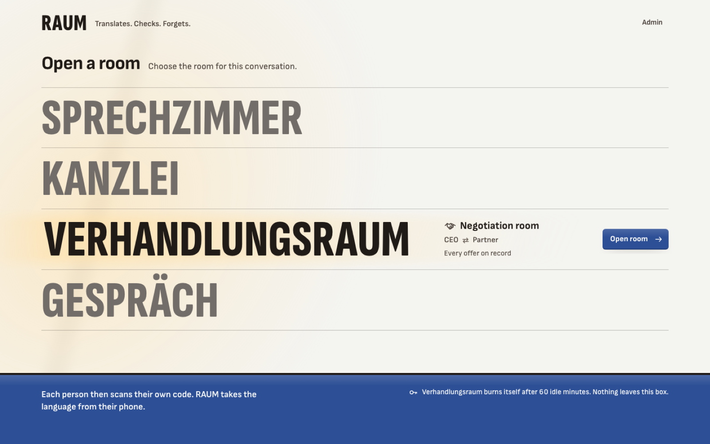
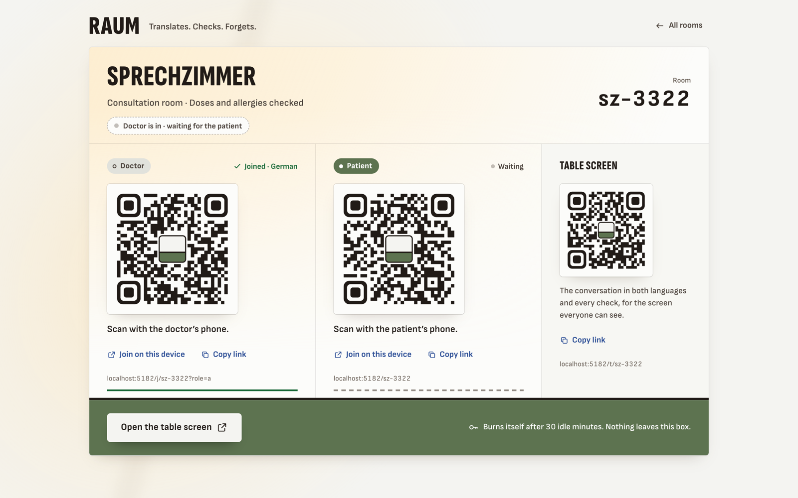
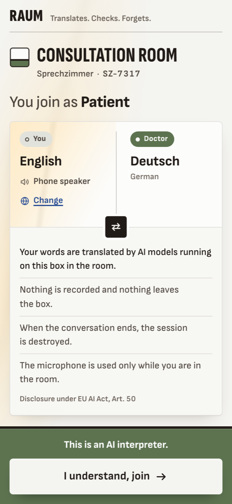
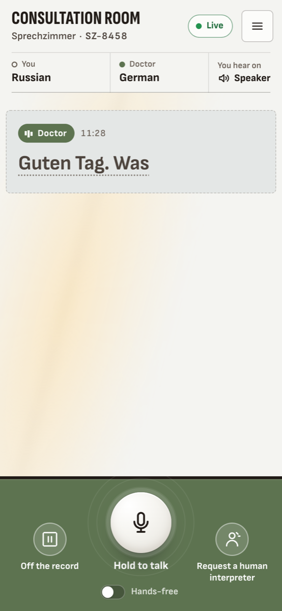
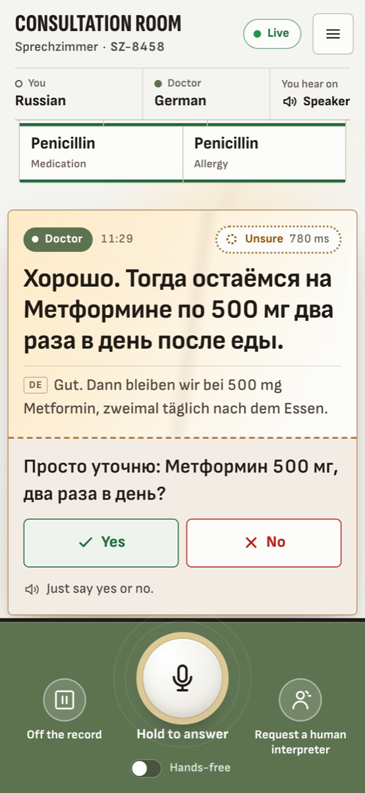
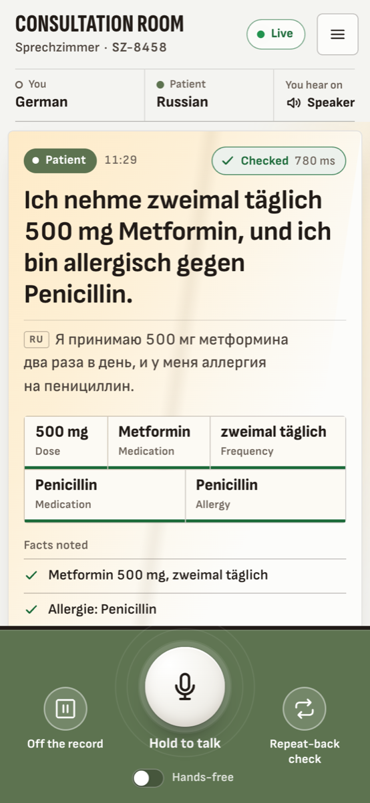

# RAUM

**Translates. Checks. Forgets.**

RAUM is a private AI interpreter that lives in the room. It translates both ways while people are still talking, checks every translation and writes the minutes. Every model runs on one box on the table: no byte goes to a third party.

Website: https://raum-website-omega.vercel.app

Built for conversations where a leak is a legal problem:

| Room | People | What RAUM guards |
|---|---|---|
| Sprechzimmer | Doctor and patient | Doses, allergies, a take-home summary in the patient's language |
| Kanzlei | Lawyer and client | Deadlines and dates, plain-language explanations the lawyer approves |
| Verhandlungsraum | CEO and foreign partner | Every price offered, minutes both sides approve |

## How it works

Everyone joins with their own device by scanning a QR code. Each sentence moves through models that all run on one box:

1. **Silero VAD** detects speech; **Smart Turn v3** and the **LiveKit turn detector** decide when a turn ends.
2. **Whisper large-v3-turbo** transcribes it, with live partials while the person talks.
3. **Gemma 4 E4B** translates it. Finished parts of a long sentence are released and voiced while the speaker keeps talking; a live draft shows on screen and is never spoken.
4. **Code** checks the numbers, doses, dates, amounts, medications and glossary names (2–4 ms). **gpt-oss-20b**, from a different model family, translates it back and **bge-m3** compares the meaning. If something is unclear, RAUM asks a spoken yes/no question.
5. **Chatterbox Multilingual** speaks it (Piper as fallback).

Measured on the box (3 Nov 2026): the voice comes about 0.65–1.0 s after a short sentence, and live text after about 1.5 s. See `eval/results/`.

Sessions are encrypted with a key held only in memory. Burn destroys the key. A hash-chained audit log records what happened, never what was said.

Reference hardware: ASUS Ascent GX10 (NVIDIA GB10). Hardware profiles for RTX PCs, Apple Silicon, Jetson and laptops are defined in `profiles/`.

## Screenshots







<table><tr>
<td></td>
<td></td>
<td></td>
<td></td>
</tr><tr><td>Join by QR code</td><td>Live translation</td><td>Read-back when unsure</td><td>Facts noted</td></tr></table>

## Run it

On any laptop, with mock models (real microphones, real voice detection, canned translations):

```bash
brew install livekit            # or any livekit-server binary
scripts/dev.sh                  # LiveKit --dev, raum-core :8000, raum-agent, app :5180
open http://localhost:5180/     # open a room: QR codes for both phones and the table screen
```

Use `scripts/dev.sh --https` so phones on the same network can use the microphone. On the box, switch `raum.yaml` to `profile: spark` and deploy with `deploy/push.sh`. Tests: `cd core && uv run pytest -q`.

| Path | What |
|---|---|
| `core/` | raum-core (FastAPI) and raum-agent (LiveKit Agents worker), Python 3.12 + uv |
| `app/` | phone and table-screen app (React, Vite, livekit-client) |
| `modes/` | the three rooms as YAML files |
| `raum.yaml`, `profiles/` | model registry and hardware profiles |
| `eval/` | test sets, evaluation, model bake-off, load test |
| `deploy/` | Caddy, LiveKit, nftables privacy meter, services, push script |
| `desktop/` | desktop app (Tauri v2): the box's web app in a window, Mac / Windows / Linux |
| `android/` | Android app (WebView): the box's web app, microphone and QR links handled natively |

## Status

Built at the Macromedia Berlin Hackathon, 2–3 November 2026. The full build plan is in [plan.md](plan.md); live status in [STATUS.md](STATUS.md).

## License

Apache 2.0. See [LICENSE](LICENSE).
